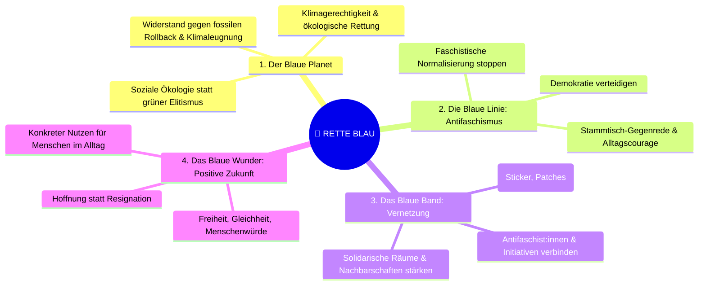

# 💙 Rette Blau 2.0: Vom Petitionsstopp zur lebendigen Bewegung

> **Strategie- & Zukunftskonzept für `rette-blau.de`**  
> **Status:** Diskussions- und Entscheidungsvorlage  
> **Branch:** `strategy/future-evolution-plan`  
> **Datum:** November 2026

---

## 1. Ausgangslage & Warum dieser Strategiewechsel notwendig ist

Die ursprüngliche Petition auf Campact/WeAct zur farblichen Kennzeichnung der AfD in den Medien hat einen wichtigen Debattenanstoß geliefert, stößt jedoch an natürliche Grenzen:
1. **Petitionsmüdigkeit:** Reine Online-Unterschriftensammlungen haben einen abnehmenden Grenznutzen, wenn sie nicht von Massenmedien dauerhaft gepusht werden.
2. **Reine Appell-Logik:** Eine Petition bittet Institutionen (Sender, Räte) um ein Handeln. Das erzeugt bei Unterstützer:innen oft Ohnmacht statt Selbstwirksamkeit.
3. **Vorhandenes Kapital:** 
   - Die Domain **`rette-blau.de`** bleibt bestehen und hat bereits Bekanntheit und Vertrauen aufgebaut.
   - **Physische Artefakte (Patches, Sticker) sind bereits im Umlauf und werden verschickt.** Das ist ein enorm wertvoller Ankerpunkt: Menschen tragen die Botschaft bereits auf Jacken, Rucksäcken und Straßenlaternen.
   - Die gesellschaftliche Notwendigkeit für Antifaschismus, Klimagerechtigkeit und soziale Solidarität ist drängender denn je.

---

## 2. Der Dreiklang der Neuausrichtung: Blau neu definieren

Statt „Rettet das Blau“ nur als Klage über eine Parteifarbe zu verstehen, erweitern wir das Symbol **BLAU** zu einem positiven, kämpferischen und verbindenden Leitmotiv:

---

## 3. Übersicht der Strategiedokumente

Dieses Zukunftspaket gliedert sich in folgende modulare Ausarbeitungen:

| Dokument | Fokus & Inhalt |
| :--- | :--- |
| [**01. Vision & Repositionierung**](./01-vision-and-repositioning.md) | Das neue Narrativ: Leitbild, Wertefundament, Zielgruppenanalyse und Transformation von der Petition zur dauerhaften Plattform. |
| [**02. Plattform-Module & Features**](./02-platform-features-and-tools.md) | Konkrete Website-Konzepte: Aktions-Radar (Vernetzung), Antifa-Alltags-Toolkit, Planet-Rescue-Schnittstelle, Sticker-/Patch-Hub. |
| [**03. Community & Straßenpräsenz**](./03-community-and-action-strategy.md) | Wie verbinden wir Menschen in der Realität? Dezentrale Vernetzung, Signal/Fediverse, lokale Bündnisse, Sticker-Aktionen, Sicherheitskonzepte. |
| [**04. Roadmap & Entscheidungsmatrix**](./04-roadmap-and-decision-matrix.md) | Phasenplan (Phase 1: Quick-Wins bis Phase 3: Vollwertige Plattform), Aufwands-/Nutzen-Matrix und konkrete Leitfragen zur Team-Entscheidung. |

---

## 4. Die Kern-Idee in einem Satz

> **„Rette Blau“ verwandelt sich von einer Petition gegen eine Parteifarbe in eine bundesweite Plattform für den Schutz unseres blauen Planeten, die Verteidigung einer offenen, antifaschistischen Gesellschaft und die solidarische Vernetzung von Menschen, die nicht aufgeben.**
