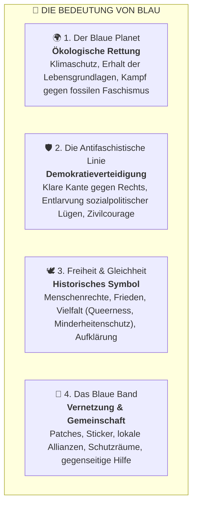

# 01. Vision & Repositionierung: Das neue Leitbild von „Rette Blau“

> **Von der Farb-Petition zur zivilgesellschaftlichen Bewegung für Planet, Freiheit und antifaschistische Solidarität.**

---

## 1. Die Diagnose: Warum Petitionen allein nicht mehr genügen

Die klassische Online-Petition basiert auf einer Prämisse des 20. Jahrhunderts: *„Wenn genug Menschen eine Unterschrift setzen, werden die Entscheidungsträger in Medien und Politik die Vernunft einsehen und handeln.“*

In der Realität von 2026 erleben wir jedoch:
- **Erodierende Brandmauern:** Rechtsextreme Narrative sickern täglich tiefer in den medialen und politischen Mainstream ein.
- **Ohnmachtsgefühl:** Menschen unterschreiben Petitionen, aber spüren keine Veränderung in ihrem Alltag, an ihrem Arbeitsplatz oder in ihrer Nachbarschaft.
- **Kombinierte Krisen:** Faschismus und Klimakatastrophe sind keine getrennten Phänomene – rechtsextreme Kräfte weltweit betreiben systematisch fossilen Rollback, leugnen die Erderwärmung und nutzen Flucht- und Krisenbewegungen für rassistische Hetze.

**Die Schlussfolgerung:**  
Die Domain `rette-blau.de` darf kein Denkmal einer beendeten Unterschriftenaktion sein. Sie muss zum **digital-analogen Werkzeugkasten und Leuchtturm** für alle werden, die der Rechtsentwicklung etwas Lebendiges, Wehrhaftes und Konstruktives entgegensetzen wollen.

---

## 2. Die Vier Dimensionen von „BLAU“

Wir erweitern das Symbol *BLAU* vom parteipolitischen Zankapfel zu einem universellen Symbol für Zukunft und Schutz:

### Dimension 1: Der Blaue Planet (Klimagerechtigkeit & Lebensgrundlagen)
- Kein Klimaschutz auf einem faschistischen Planeten: Rechtsextreme Strömungen bekämpfen erneuerbare Energien und leugnen die planetaren Grenzen.
- „Rette Blau“ erinnert an die Erde als „Pale Blue Dot“ (Carl Sagan): Die einzige Heimat, die wir haben.
- Rettung des Planeten muss sozial gerecht gestaltet sein – nicht als Wohlstandsprivileg, sondern als Grundrecht für alle.

### Dimension 2: Antifaschismus als Grundhaltung
- Antifaschismus ist kein Extremismus, sondern die verfassungsmäßige Pflicht und moralische Mindestanforderung an jede demokratische Gesellschaft.
- Demaskierung der AfD und faschistischer Kader: Sie stehen nicht für den „kleinen Mann“, sondern für Neoliberalismus für Vermögende, Spaltung und Zerstörung von Arbeiterrechten.
- Kultur des Widerspruchs: Den öffentlichen Raum nicht den Rechten überlassen – weder digital noch auf der Straße.

### Dimension 3: Freiheit, Gleichheit & soziale Güter
- Blau ist traditionell die Farbe der UN (Frieden), der Aufklärung und der Sehnsucht nach Freiheit.
- Wir fordern eine Gesellschaft ein, in der niemand Angst vor Verfolgung, Armut oder Diskriminierung haben muss – unabhängig von Herkunft, Glaube, Geschlecht oder sexueller Orientierung.

### Dimension 4: Das solidarische Netzwerk (Das Blaue Band)
- Die bereits verschickten Patches und Sticker sind physische Erkennungszeichen im Alltag: *„Hier bist du nicht allein.“*
- Verknüpfung von isolierten Menschen in Kleinstädten und Dörfern mit überregionalen Netzwerken und lokalen Verbündeten.

---

## 3. Zielgruppen & Personas

Um konkreten Nutzen zu stiften, muss die Plattform für unterschiedliche Lebensrealitäten Mehrwert bieten:

### Persona A: „Die Isolierte im ländlichen Raum“ (z. B. Mara, 28, Erzieherin in Sachsen-Anhalt)
- **Problem:** Im Dorf oder der Kleinstadt dominieren rechte Sprüche und Symbolik. Sie fühlt sich ohnmächtig und isoliert.
- **Was `rette-blau.de` ihr gibt:** 
  - Finden von diskreten Gleichgesinnten und Beratungsstellen in der Region über das Aktions-Radar.
  - Sticker & Patches, um subtil oder offen Flagge zu zeigen.
  - Notfallkontakte für Bedrohungs- und Diskriminierungssituationen.

### Persona B: „Der Alltags-Pragmatiker“ (z. B. Cem, 42, Betriebsrat in NRW)
- **Problem:** Kolleg:innen teilen rechte TikTok-Fakes zu Bürgergeld, Rente oder Geflüchteten. Er will dagegenhalten, ihm fehlen aber prägnante Fakten.
- **Was `rette-blau.de` ihm gibt:**
  - 30-Sekunden-Faktenchecks und downloadbare Infokarten („AfD-Politik gegen Arbeitnehmer“).
  - Klare Argumente ohne ideologisches Fachchinesisch.

### Persona C: „Die Klima-Aktivistin“ (z. B. Lena, 21, Studentin)
- **Problem:** Frustration über den Stillstand bei der Klimawende und die aggressive Hetze gegen Klimaaktivist:innen.
- **Was `rette-blau.de` ihr gibt:**
  - Die Brücke zwischen Antifaschismus und Klimagerechtigkeit („Klimakrise ist eine Demokratiekrise“).
  - Kampagnenmaterial und gemeinsame Aktionstage.

---

## 4. Werte-Charta & Selbstverständnis

1. **Konsequent antifaschistisch, kompromisslos menschenfreundlich:** Wir bekämpfen jede Form von Rassismus, Antisemitismus, Queerfeindlichkeit, Ableismus und Sozialdarwinismus.
2. **Parteipolitisch unabhängig, gesellschaftlich parteiisch:** Wir werben nicht für Parteien, sondern für Grundrechte, das Grundgesetz, sozialen Ausgleich und planetare Überlebensfähigkeit.
3. **Selbstwirksamkeit vor Verzweiflung:** Die Seite soll nicht deprimieren („Alles wird schlimmer“), sondern ermächtigen („Das kannst du heute tun“).
4. **Kombination aus Digital & Real:** Ein Sticker an der Bushaltestelle oder ein Patch an der Jacke wiegt oft mehr als 1.000 Likes im Internet.

