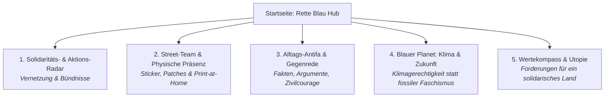

# 02. Plattform-Module & Features: Die Werkzeuge von „Rette Blau“

> **Konzeptionelle Ausarbeitung der neuen Website-Architektur und Mehrwert-Funktionen.**

---

## 1. Übersicht der Seitenarchitektur

Die Seite `rette-blau.de` wird von einem eindimensionalen Petitions-One-Pager zu einem dynamischen, modularen **Aktions- und Informations-Hub** umgestaltet:

---

## 2. Modul 1: Solidaritäts- & Aktions-Radar (Vernetzung)

### Problem
Viele Menschen, insbesondere außerhalb von Großstädten, fühlen sich mit ihrer antifaschistischen und demokratischen Haltung isoliert und wissen nicht, wer vor Ort aktiv ist oder wo man Unterstützung findet.

### Feature-Beschreibung
Eine datenschutzfreundliche, interaktive Deutschlandkarte (und Filter-Suche nach Bundesland / Postleitzahl):
- **Bündnisse vor Ort:** Omas gegen Rechts, lokale Bündnisse gegen Rechts, Seebrücke, Fridays for Future, autonome Zentren, Gewerkschaftsjugend.
- **Beratung & Schutz:** Verlinkung zu den professionellen Opferberatungsstellen für Betroffene rechter Gewalt (VBRG-Netzwerk wie MOBIT, ReachOut, ezra, respondiert bundesweit).
- **Aktionen & Demos:** Kuratierte Übersicht über bundesweite Großdemonstrationen und regionale Proteste.

### Technischer & Datenschutz-Ansatz
- Keine Nutzerverfolgung (kein Google Maps, stattdessen OpenStreetMap / Leaflet oder rein statische SVG-Karten).
- Kuratierte Datenbank als statisches JSON/Markdown, redaktionell geprüft, um Missbrauch oder doxxing-Gefahren durch rechtsextreme Akteure von vornherein auszuschließen.

---

## 3. Modul 2: Street-Team & Physische Präsenz (Patches & Sticker)

### Ausgangslage
Patches und Sticker existieren bereits und werden verschickt. Sie sind das wirksamste Werkzeug, um die Botschaft in die analoge Welt zu tragen.

### Features
1. **Bestell- & Soli-Formular:**
   - Einfache Möglichkeit, Sticker-Packs und gewebte Patches gegen Spende / Portokosten zu bestellen.
   - „Soli-Modell“: Wer Geld hat, bezahlt etwas mehr, damit Menschen ohne Geld kostenfrei Sticker erhalten.
2. **Print-at-Home Hub (Open Source Protestmaterial):**
   - Vektordateien & Druckvorlagen (DIN A4 / A3 / DIN A7 für Sticker).
   - Sprühschablonen-Vorlagen (Stencils) für Straßenkreide oder Banner.
   - Slogans: *„Blau ist der Planet – nicht die Hetze“*, *„Faschismus ist keine Farbe, sondern ein Verbrechen“*, *„Solidarität ist unteilbar“*.
3. **Mitmach-Aktion „Blaues Band“ (Foto-Feed / Wall of Solidarity):**
   - Bilder von Stickern und Patches an Fahrrädern, Laternen, Taschen oder Bannern.
   - **Sicherheitsfilter:** Automatisches Entfernen von EXIF/Geodaten und Gesichtern zur Wahrung der Anonymität der Unterstützer:innen.

---

## 4. Modul 3: Alltags-Antifa Toolkit (Gegenrede & Fakten)

### Problem
Menschen geraten im Alltag (Familienfeiern, Pausenraum, Sportverein, WhatsApp-Gruppen) in Situationen, in denen rassistische oder faschistische Parolen fallen, und sind sprachlos.

### Features
1. **Pocket-Faktenchecks (30-Sekunden-Karten):**
   - Nutzt das bereits im Repository erarbeitete Faktenmaterial (`docs/afd-realitaet-faktendossier-rechtsextremismus-und-sozialpolitik.md`).
   - Themenkarten:
     - *„Wer bezahlt wirklich für wen?“* (AfD-Steuerpläne entlasten Milliardäre, nicht Arbeiter).
     - *„Fachkräftemangel vs. Remigration“* (Zusammenbruch des Pflegesystems bei rechtsextremer Politik).
     - *„Freiheit vs. Zensur“* (Wie Faschisten Kultur und freie Medien zerstören).
2. **Deeskalations- & Argumentations-Leitfaden:**
   - Wann lohnt sich Diskussion? Wann hilft nur eine klare Grenzziehung („Bis hierher und nicht weiter“)?
   - Wie schützt man Betroffene vor Ort?
3. **Shareable Social-Cards:**
   - Schnelle Grafiken zum Teilen in WhatsApp-Status, Instagram, Bluesky und Mastodon.

---

## 5. Modul 4: „Rettet den Blauen Planeten“ (Klima & Antifaschismus)

### Problem
Die Klimakatastrophe und das Erstarken des Faschismus werden oft getrennt diskutiert. Tatsächlich sind sie eng verzahnt: Rechtsextreme propagieren die fossile Abhängigkeit weiter und betreiben Sündenbockpolitik gegen Schwache, wenn Ressourcen knapp werden.

### Features
1. **Themenreihe „Klimaschutz ist Antifaschismus“:**
   - Aufdeckung von Desinformationskampagnen fossiler Lobbys und rechter Parteien.
   - Zeigen, wie der globale Süden und marginalisierte Gruppen am stärksten unter der Erderwärmung leiden.
2. **Konkrete planetare Schutzprojekte:**
   - Verlinkung von Initiativen zum Schutz von Mooren, Wäldern und Gewässern in Deutschland und global.
   - Aufruf zu lokalem ökologischem Engagement (Urban Gardening, Renaturierung, Verkehrswende vor Ort).

---

## 6. Modul 5: Der Wertekompass (Die positive Utopie)

### Ansatz
Rechtsextreme leben von Angst, Frustration und Hass. Reine Abwehrreaktionen reichen nicht aus. Menschen brauchen ein positives Bild davon, wie ein gutes Leben für alle aussehen kann.

### Kernbotschaften („Das Freie Blau“):
1. **Gute Arbeit & soziale Sicherheit:** Niemand darf in Existenzangst leben. Wenn der Staat soziale Sicherheit garantiert, verliert die Hetze ihren Nährboden.
2. **Gleiche Rechte & Freiheit für alle:** Eine Gesellschaft, in der niemand wegen Herkunft, Geschlecht, sexueller Identität oder Handicap zurückbleibt.
3. **Ökologischer Wohlstand:** Saubere Luft, intakte Natur, bezahlbare Mobilität und gesunde Lebensmittel als Gemeingüter statt Profitobjekte.
4. **Lebendige Demokratie:** Mehr Bürgerbeteiligung, starke Zivilgesellschaft und Null Toleranz gegen Feinde der Menschenwürde.
