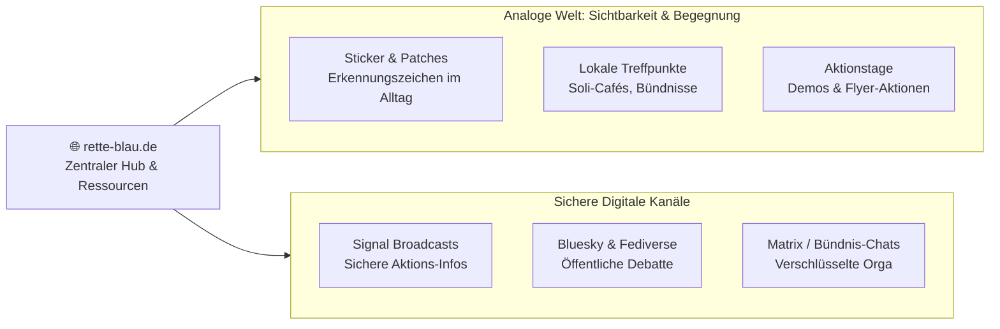

# 03. Community- & Aktionsstrategie: Wie wir Menschen verbinden

> **Konzepte zur sicheren, nachhaltigen Vernetzung von Antifaschist:innen und Engagierten in der echten Welt und im Netz.**

---

## 1. Die Herausforderung: Vernetzung ohne Sicherheitsrisiko

Die Vernetzung antifaschistischer und zivilgesellschaftlicher Akteure birgt in Zeiten von rechtsextremen „Feindeslisten“, Doxxing und digitalem Hass erhebliche Sicherheitsrisiken.

**Wichtiges Leitprinzip:**  
Wir bauen **kein eigenes soziales Netzwerk** (hoher Wartungsaufwand, Datenschutzrisiken, Angriffsfläche für Trolle). Stattdessen nutzen wir das Prinzip eines **dezentralen Hubs** und verknüpfen bestehende, sichere Kanäle und physische Knotenpunkte.

---

## 2. Die physische Verbindung: Das „Blaue Band“ im Alltag

### 2.1 Der Patch als Erkennungszeichen

- **Wirkung:** Wenn jemand im Zug, in der Schule oder auf der Straße einen „Rette Blau“-Patch an einer Tasche sieht, bricht das Gefühl der Isolation. Es signalisiert: _„Hier ist eine Person, bei der du sicher bist, wenn es brenzlig wird.“_
- **Aktion „Zeig dein Blau“:** Aufruf an Unterstützer:innen, Patches gut sichtbar an Rucksäcken, Jacken oder Mützen zu tragen.

### 2.2 Sticker-Verteilung & Straßenpräsenz

- **Sticker-Patenschaften:** Aktive können „Sticker-Packs“ bestellen und für ihren Kiez, ihr Dorf oder ihren Campus die Patenschaft übernehmen.
- **Konstruktives Überkleben:** Rechtsextreme Propaganda (die im öffentlichen Raum oft jahrelang unbehelligt klebt) gezielt mit positiven, antifaschistischen und klimafreundlichen Botschaften überkleben.
- **Rechtlicher Hinweis & Sicherheit:** Aufklärung über lokale Vorschriften, Vermeidung von Sachbeschädigung (z. B. keine privaten Schaufenster oder Denkmäler) und Achtsamkeit vor Neonazi-Übergriffen beim Kleben.

---

## 3. Digitale Vernetzungskanäle

| Kanal                      | Zweck                                                                                 | Sicherheits- & Datenschutzlevel                                                      |
| :------------------------- | :------------------------------------------------------------------------------------ | :----------------------------------------------------------------------------------- |
| **Signal-Broadcast-Kanal** | 1-Weg-Informationen über Demos, neue Materialien, Eil-Aktionen                        | 🟢 Sehr hoch (Ende-zu-Ende-verschlüsselt, keine Sichtbarkeit anderer Abonnenten)     |
| **Bluesky & Mastodon**     | Diskurs, Teilen von Fact-Cards, Vernetzung mit Journalist:innen und Zivilgesellschaft | 🟡 Öffentlich, dezentral, resistent gegen Plattform-Monopole (X/Twitter-Alternative) |
| **Matrix-Räume**           | Koordinierung für lokale Gruppen und Moderator:innen                                  | 🟢 Hochverschlüsselt, dezentral, Open Source                                         |
| **Website-Newsletter**     | Monatlicher Digest mit Erfolgsgeschichten und neuen Druckvorlagen                     | 🟢 DSGVO-konform, Double-Opt-In, gehostet in der EU                                  |

---

## 4. Kooperationen mit bestehenden Bündnissen

Statt das Rad neu zu erfinden, dockt „Rette Blau“ an die wichtigsten zivilgesellschaftlichen Akteure an und bietet ihnen eine Plattform:

1. **Omas gegen Rechts:** Generationenübergreifender Schulterschluss; gemeinsame Aktionen gegen Rassismus.
2. **VBRG (Verband der Beratungsstellen für Betroffene rechter, rassistischer und antisemitischer Gewalt):** Fachlich fundierte Hilfsangebote direkt prominent auf der Website verlinken.
3. **Klima- & Umweltverbände (z. B. Naturfreunde, BUNDjugend, FFF):** Zusammenarbeit bei Kampagnen gegen fossile Desinformation und für sozial gerechten Klimaschutz.
4. **Aufstehen gegen Rassismus / Seebrücke:** Unterstützung von bundesweiten Aktionstagen und Protesten gegen Abschiebungen und rechte Gesetzesverschärfungen.

---

## 5. Sicherheits- und Schutzleitlinien für Aktive

Um Menschen zu schützen, etablieren wir klare Schutzprinzipien auf der Plattform:

- **Keine persönlichen Daten im Klartext:** Auf der Website werden keine Privatadressen von Einzelpersonen gelistet, sondern ausschließlich offizielle Bündnis- oder Vereinsadressen.
- **Tipp für Aktive vor Ort:** Niemals allein nachts plakatieren oder stickern; immer in Zweierteams unterwegs sein; verdächtige Aktivitäten rechtsextremer Gruppen sofort den lokalen Opferberatungsstellen melden.
- **Digitale Hygiene:** Anleitungen auf der Website zur sicheren Smartphone-Nutzung bei Demonstrationen (Sperrbildschirm mit Code statt Face-ID, Deaktivierung von Biometrie, verschlüsselte Messenger).
