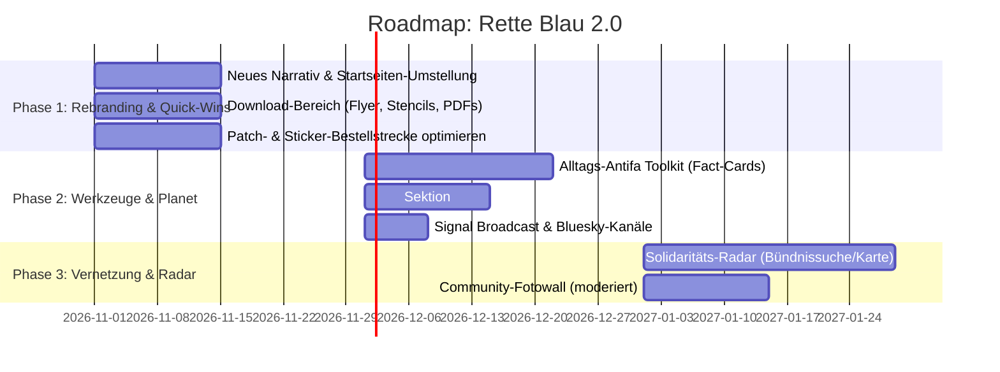

# 04. Roadmap & Entscheidungsmatrix: Nächste Schritte für das Team

> **Phasenplan, Handlungsoptionen und konkrete Diskussionsfragen zur gemeinsamen Richtungsentscheidung.**

---

## 1. Die drei strategischen Optionen im Vergleich

Bevor Code geschrieben wird, sollte das Team entscheiden, welche Hauptausrichtung priorisiert werden soll:

| Option | Fokus | Entwicklungsaufwand | Pflegeaufwand | Hebelwirkung |
| :--- | :--- | :--- | :--- | :--- |
| **Option A: Der „Werkzeugkasten“ (Ressourcen- & Content-Hub)** | Downloadbares Material, Faktenchecks, Argumentationskarten, Sticker-Bestellungen. | 🟢 Gering (1–2 Wochen) | 🟢 Sehr gering (statischer Content) | 🟡 Solide; direkte Unterstützung für Einzelne im Alltag. |
| **Option B: Das „Aktions- & Bündnis-Radar“ (Vernetzungs-Plattform)** | Interaktive Deutschlandkarte, Suche nach lokalen Initiativen, Terminkalender für Demos & Workshops. | 🟡 Mittel (3–4 Wochen) | 🟡 Mittel (monatliche Kuratierung der Bündnisliste) | 🟢 Sehr hoch; überwindet das Gefühl der Isolation im ländlichen Raum. |
| **Option C: Die „Street-Art & Soli-Bewegung“ (Physisch im Fokus)** | Patches & Sticker als Kern; Mitmach-Aktionen im realen Raum; Galerie von Straßenaktionen; Soli-Shop. | 🟢 Gering–Mittel | 🟡 Mittel (Versandlogistik & Moderation) | 🟢 Sehr hoch für Straßenpräsenz und visuelle Rückeroberung. |
| **Empfohlene Synthese: Schrittweiser Ausbau (A → C → B)** | Schneller Launch der nützlichen Ressourcen & Sticker, anschließender Ausbau zur interaktiven Vernetzung. | Skalierbar | Skalierbar | 🚀 Maximaler ROI bei minimalem Risiko. |

---

## 2. Phasenplan (Roadmap)

---

### Phase 1: Sofort-Maßnahmen & Re-Framing (Kurzfristig)
- **Startseiten-Hero überarbeiten:** Textlicher Schwenk vom reinen Petitionsaufruf hin zum breiteren Bündnis für Demokratie, Klimagerechtigkeit und Zivilcourage. Die Petition bleibt als historischer Schritt/Sekundärlink sichtbar, steht aber nicht mehr als alleinige Handlungsoption im Zentrum.
- **Street-Team Hub etablieren:** Übersicht, wie man an Patches und Sticker kommt (Bestellformular oder Soli-Kauf).
- **Print-at-Home PDF-Sektion:** Download fertiger Druckvorlagen für Sticker, Plakate und Abreißzettel für das Schwarze Brett.

### Phase 2: Wissens- & Utopie-Ausbau (Mittelfristig)
- **Alltags-Antifa Fact-Cards:** Interaktive oder herunterladbare Faktenmodule (basierend auf den vorhandenen Dossiers) gegen rechtsextreme Lügen.
- **Sektion „Der Blaue Planet“:** Zusammenhänge zwischen autoritärer Herrschaft und Zerstörung der Biosphäre; Warum echter Naturschutz antifaschistisch ist.
- **Social Media Kanäle aktivieren:** Bluesky und Signal für verlässliche Reichweite ohne Big-Tech-Algorithmen.

### Phase 3: Aktions-Radar & Community-Features (Langfristig)
- **Aktions- & Bündnis-Radar:** Interaktive, datenschutzkonforme Karte für lokale Beratungsstellen, Soli-Orte und Initiativen.
- **Wall of Solidarity:** Verpixelte, moderierte Einsendungen von Stickern und Patches aus ganz Europa.

---

## 3. Leitfragen für das Team-Meeting / Die Entscheidung

Um die nächsten Schritte verbindlich festzulegen, sollte das Kernteam folgende Fragen diskutieren:

1. **Zur Identität & Name:**
   - Passt der Name `rette-blau.de` zum erweiterten Konzept (Erde/Planet + antifaschistischer Schutzraum + historische Symbolik)?
   - *Vorschlag:* Ja, die Domain ist eingängig und erhält durch die Storyline *„Blau ist der Planet – Blau ist die Freiheit – Blau ist nicht braun“* eine viel tiefere Bedeutung.

2. **Zu den physischen Patches & Stickern:**
   - Wie ist die aktuelle Versandlogistik aufgestellt? Können Bestellungen über ein Formular auf der Website automatisiert werden?
   - Soll es ein festes Spendenmodell (z. B. via Betterplace, PayPal-Soli oder Überweisung) geben?

3. **Zur thematischen Gewichtung:**
   - Welcher Bereich ist euch am wichtigsten:
     - [ ] Der **Bündnis- und Vernetzungs-Aspekt** (Menschen zusammenbringen)?
     - [ ] Das **Wissens- und Fakten-Toolkit** (Aufklärung und Gegenrede)?
     - [ ] Die **Klima- und Planeten-Perspektive** (Schnittstelle Ökologie & Demokratie)?
     - [ ] Die **Straßenpräsenz** (Sticker, Patches, Aktionen)?

4. **Nächste technische Schritte:**
   - Sobald Einigkeit über die Prioritäten herrscht, können wir die bestehende React/Vite/Tailwind-Architektur modular und leichtgewichtig auf die neuen Sektionen anpassen.
