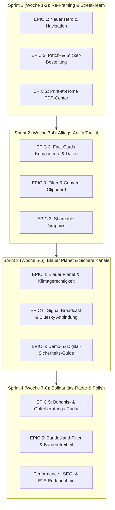

# 06. Sprint-Backlog, Architektur & Technische Umsetzung

> **Technischer Leitfaden, Komponenten-Architektur und Sprint-Planung für das Entwicklungsteam.**

---

## 1. Technische Architektur & Komponentenstruktur

Das Projekt basiert auf **React 19**, **Vite**, **Tailwind CSS v4** und statischem Prerendering (SSG via `scripts/prerender.js`). Alle neuen Module müssen so konzipiert sein, dass sie **statisch prerenderbar**, **extrem schnell ladend** und **100 % datenschutzkonform (keine Drittanbieter-Tracker)** bleiben.

### Geplante Komponenten-Hierarchie in `src/`:

```
src/
├── components/
│   ├── SiteHeader.tsx                 # [Modifiziert: Neue Modul-Navigation & Anker]
│   ├── HeroSection.tsx                # [Modifiziert: Neues Leitmotiv & Multi-CTAs]
│   │
│   ├── street-team/                   # [NEUES MODUL: Epic 2]
│   │   ├── MerchSection.tsx           # Patches & Sticker Vorstellung mit Mengenauswahl
│   │   ├── OrderModal.tsx             # Zugängliches Soli-Bestellformular
│   │   ├── PrintAtHomeSection.tsx     # Download-Center für Plakate & Stencils
│   │   └── StreetPhotoGallery.tsx     # Vorschau/Einsendung von Aktionen
│   │
│   ├── toolkit/                       # [NEUES MODUL: Epic 3]
│   │   ├── FactCardsSection.tsx       # Übersicht mit Themenfiltern
│   │   ├── FactCardItem.tsx           # Aufklappbare 30-Sekunden-Karte mit Kontersatz
│   │   ├── DeescalationGuide.tsx      # Argumentationshilfe & Zivilcourage
│   │   └── ShareCardModal.tsx         # Bildexport / Web Share API
│   │
│   ├── planet/                        # [NEUES MODUL: Epic 4]
│   │   ├── BluePlanetSection.tsx      # Hauptsektion: Klima & Antifaschismus
│   │   └── PlanetaryBoundaries.tsx    # Visuelle Infografik der planetaren Grenzen
│   │
│   ├── radar/                         # [NEUES MODUL: Epic 5]
│   │   ├── SolidarityRadarSection.tsx # Bündnissuche nach Bundesland/Kategorie
│   │   ├── InitiativeCard.tsx         # Visitenkarte einer Organisation/Hilfestelle
│   │   └── SuggestInitiativeModal.tsx # Formular zur redaktionellen Prüfung
│   │
│   ├── community/                     # [NEUES MODUL: Epic 6]
│   │   ├── ConnectChannelsSection.tsx # Signal-Broadcast, Bluesky, Mastodon
│   │   └── SafetyGuideSection.tsx     # 5 Regeln für digitale & physische Demo-Sicherheit
│   │
│   ├── SiteFooter.tsx                 # [Modifiziert: Neue Links & Impressum/Datenschutz]
│   └── ... (Bestehende Komponenten: WhySection, PolicyDangersSection bleiben als Unterseiten/Archiv)
│
├── data/                              # [Statische Datenmodelle - Type-Safe]
│   ├── factCards.ts                   # Alle Faktenchecks & Kontersätze
│   ├── initiativesDirectory.ts        # Kuratierte Liste aller 16 Bundesländer + Beratungsstellen
│   ├── downloads.ts                   # Metadaten der PDFs, Plakate & Stencils
│   └── merchandise.ts                 # Patch- & Sticker-Spezifikationen
│
└── i18n/
    ├── de.json                        # Aktualisierte deutsche Übersetzungen
    └── en.json                        # Aktualisierte englische Übersetzungen
```

---

## 2. TypeScript-Datenstrukturen (`src/data/`)

### 2.1 Fact-Cards (`factCards.ts`)
```typescript
export interface FactCard {
  id: string;
  category: 'social' | 'climate' | 'migration' | 'democracy';
  claim: string;           // Die rechtsextreme Schutzbehauptung
  reality: string;         // Die nachweisbare Faktenlage
  counterSnippet: string;  // 10-Sekunden-Kontersatz für den Familientisch/Betrieb
  source: {
    title: string;         // z.B. "Deutsches Institut für Wirtschaftsforschung (DIW)"
    url: string;
  };
  shareableImage?: string; // Optionaler Pfad zu fertiger Social-Grafik
}
```

### 2.2 Initiativen & Bündnisse (`initiativesDirectory.ts`)
```typescript
export interface Initiative {
  id: string;
  name: string;
  state: 'BW' | 'BY' | 'BE' | 'BB' | 'HB' | 'HH' | 'HE' | 'MV' | 'NI' | 'NW' | 'RP' | 'SL' | 'SN' | 'ST' | 'SH' | 'TH' | 'federal';
  category: 'counseling' | 'alliance' | 'climate' | 'youth';
  description: string;
  website: string;
  emergencyContact?: string; // z.B. Telefonnummer der Opferberatungsstelle
  isVerified: boolean;
}
```

---

## 3. Sprint-Planung & Iterationen (4 Sprints à 2 Wochen)



---

## 4. Definition of Ready (DoR) & Definition of Done (DoD)

### Definition of Ready (DoR) – Wann darf eine Story begonnen werden?
1. Die Story hat ein eindeutiges User-Story-Format mit klar formuliertem Mehrwert.
2. Akzeptanzkriterien sind vollständig und testbar definiert.
3. Texte liegen für beide Sprachen (`de` und `en`) vor oder sind im Team abgestimmt.
4. Benötigte Bild-Assets (Patches, Sticker, PDFs) liegen in optimierter Form vor.

### Definition of Done (DoD) – Wann gilt eine Story als fertig?
1. **TypeScript-Strict:** Keine `any`-Typen, `npm run build` kompiliert ohne Fehler.
2. **Linting & Format:** `npm run lint` (oxlint) und `prettier` laufen ohne Fehler durch.
3. **i18n-Konsistenz:** `npm run i18n:check` bestätigt Parität zwischen `de.json` und `en.json`.
4. **Automatisierte Tests:**
   - Unit-Tests (`npm run test:unit`) für alle neuen interaktiven Komponenten mit mind. 80% Abdeckung.
   - Playwright E2E-Tests (`npm run test:e2e`) für kritische Workflows (Bestellmodal, Fact-Card Filter).
5. **SSG-Validierung:** Das SSG-Prerendering (`npm run ssg`) erzeugt sauberes HTML ohne Hydration-Mismatches.
6. **Barrierefreiheit:** Tastaturnavigierbarkeit (Focus-States, ARIA-Labels) und Screenreader-Tauglichkeit.
